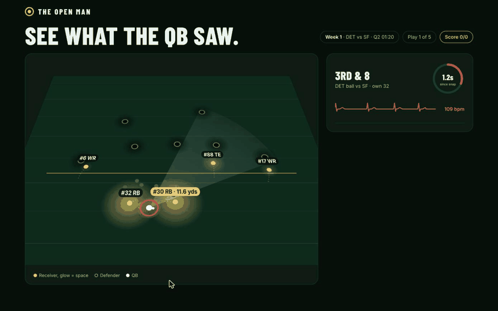
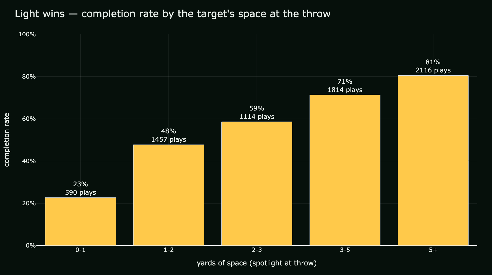
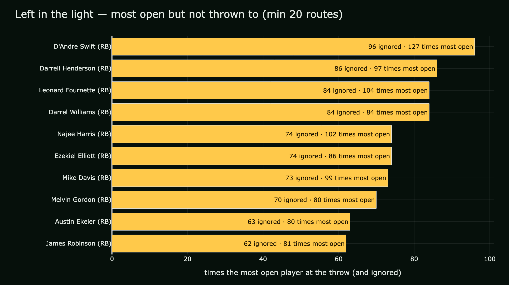

# The Open Man: see what the QB saw

**How open was every receiver the moment the ball left the QB's hand?**

A one-page experience: a real NFL pass play replays on a night field. Each
receiver glows with a gold spotlight: the more space he has from the nearest
defender, the bigger and brighter his light. The play freezes just before the
throw and asks **"Who would you throw to?"**, then reveals what the real QB did.



**How it plays:** 5 real interceptions where the QB missed the open man.
For each one you get a freeze, a pick, and a reveal ("The pro missed it",
"Same read as the pro" or "You both missed it"), with a running score. A faint
**"QB's eyes"** cone shows which way the QB was facing (tracking orientation),
versus where the light was. After the 5th play you get a **share card** with
your QB vision score, which you can download as a PNG.

**Play it live:** https://salmarahim04.github.io/the-open-man/
(or open `web/openman.html` locally: double-click works, no server).

## The showcase play

Week 1, DET vs SF, 3rd & 8. Jared Goff throws to tight end **T.J. Hockenson**,
who has **1.9 yards** of space. It's picked off by **Dre Greenlaw** and
returned 39 yards for a touchdown. Meanwhile
running back **Jamaal Williams** stands **11.9 yards** clear of anyone.

## The Spotlight Score

One simple number: the distance (yards) from a receiver to the nearest coverage
defender (PFF role "Coverage"), at every frame. Bigger = more open.

## What the data says

Across 122 games and **7,583 pass plays** (2021 season, weeks 1-8, 10 frames/s):

### 1. Light wins: open receivers get caught



| Space at throw | Completion rate | Plays |
|---------------:|:---------------:|------:|
| 0-1 yd         | **23%**         | 590   |
| 1-2 yd         | 48%             | 1,457 |
| 2-3 yd         | 59%             | 1,114 |
| 3-5 yd         | 71%             | 1,814 |
| 5+ yd          | **81%**         | 2,116 |

A wide-open target (5+ yds) is caught 3.5x more often than one in tight coverage.

### 2. Left in the light: the ignored open man is a running back



Counting every time a player was the most open receiver at the throw but did
not get the ball (min 20 routes), **the whole top 10 are running backs**.
**D'Andre Swift** (#32 in the showcase play) was the most open man 127 times
and ignored on 96 of them. QBs lock onto the downfield read and leave the
checkdown standing in the light.

## Project layout

```
web/openman.html        the interactive experience (single file, plain HTML/CSS/JS)
web/showcase.js         the play data (window.SHOWCASE = {...}), made by export_play.py
src/export_play.py      exports one play for the page (--auto finds a showcase)
src/build_spotlight.py  spotlight score for every receiver, every frame, every game
src/pick_showcase.py    ranks "missed open man" interceptions
src/charts.py           the two insight charts (outputs/*.png)
src/replay.py           a Plotly replay of one play (outputs/replay.html)
design/                 the UI mockups
```

## Run it yourself

```bash
# 1. Data (~826 MB, git-ignored) from
#    https://github.com/ThompsonJamesBliss/nfl-big-data-bowl-regional-event-data
git clone --depth 1 https://github.com/ThompsonJamesBliss/nfl-big-data-bowl-regional-event-data.git ../bdb-data
ln -s ../bdb-data/data data

# 2. Python deps
pip install -r requirements.txt        # pandas numpy plotly kaleido pyarrow

# 3. Analysis + charts (~30 s)
python3 src/build_spotlight.py
python3 src/pick_showcase.py
python3 src/charts.py

# 4. Export a play for the page
python3 src/export_play.py --auto --top 5                 # the 5 plays used in the game (first 20 games)
python3 src/export_play.py --game 2021101706 --play 1861  # or any play
```

Then open `web/openman.html`. Tip: `web/openman.html#freeze` jumps straight to
the freeze for demos. The heartbeat line speeds up as the pocket clock runs;
"Sound on" adds a heartbeat thump (off by default).

## Data

NFL Big Data Bowl 2023 data (NFL Next Gen Stats tracking + PFF scouting),
2021 season weeks 1-8, via
https://github.com/ThompsonJamesBliss/nfl-big-data-bowl-regional-event-data.
The data is not included in this repo.
