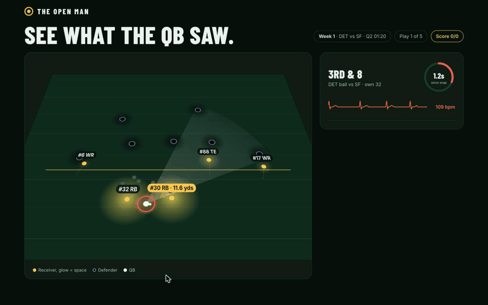

# The Open Man: see what the QB saw

### ▶ [Play it now](https://salmarahim04.github.io/the-open-man/) · no install, no sign-up, 2 minutes

---

## "He was wide open!"

Every football fan has yelled it at the TV. A running back stands alone in the
flat, the quarterback forces the ball into coverage, and it gets picked off.

The TV replay shows **where the ball went**. It never shows **what the QB could
have done**: open space doesn't show up on a broadcast. Until now.

## Space you can see

**The Open Man turns open space into light.**

We take real NFL player-tracking data, 10 frames a second, every player on the
field, and replay the play on a night field. Every receiver carries a gold
spotlight. **The more room he has from the nearest defender, the bigger and
brighter he glows.** Defenders are dark shapes that eat the light around them.

Suddenly the read is obvious. You can *see* the open man.

## Then we hand you the ball

1. **Watch the snap.** A real play unfolds. The pocket clock ticks, the QB's
   heartbeat races, a cone shows where he's looking.
2. **The freeze.** A heartbeat before the real throw, the play stops:
   *"Tap the light to throw."*
3. **Your call.** Tap the receiver you'd throw to.
4. **The reveal.** We show what the NFL quarterback actually did, and the stamp
   doesn't lie: **THE PRO MISSED IT**, **SAME READ AS THE PRO**, or
   **YOU MADE THE SAME MISTAKE**.

Five real interceptions. A running score. At the end, a **share card** with
your QB vision score, ready to post.

## The play that sells it

Week 1, Lions vs 49ers, 3rd & 8. Jared Goff throws to a tightly covered
T.J. Hockenson, **1.9 yards** of space. Dre Greenlaw picks it off and runs it
back 39 yards for a touchdown.

Meanwhile, running back **Jamaal Williams** stood alone in **11.9 yards of
light**. On our field, he's the brightest thing on the screen. You'll see him.
The pro didn't.

## This isn't a gimmick. The light is real.

We measured the Spotlight Score (yards to the nearest defender in coverage)
for every receiver at every throw: **122 games, 7,583 pass plays**.

| | |
|---|---|
| **81% vs 23%** | Targets with 5+ yards of space are caught 81% of the time. In tight coverage (0-1 yd): 23%. **Light wins, 3.5x.** |
| **10 of 10** | The ten receivers most often left wide open and ignored are **all running backs**. |
| **96 of 127** | D'Andre Swift was the most open man on the field 127 times and didn't get the ball on 96 of them. |


Quarterbacks lock onto the downfield read and leave the checkdown standing in
the light. The Open Man makes that visible to anyone, in one glance.

## Who it's for

- **Fans:** a 2-minute game that makes you feel like a quarterback, and a
  score card you'll want to share.
- **Broadcasters:** a replay segment that explains a bad read in five seconds
  without a telestrator.
- **Coaches and players:** a visual way to train the read: find the light,
  before the pocket collapses.

## Where it goes next

- **Today's 10 throws:** a fresh daily set drawn from all 7,583 dropbacks.
- **Live:** light up the open man on the replay minutes after the play happens.
- **QB rankings:** who finds the light most often, and who leaves it on the field.

---

## Under the hood

- **One file, zero dependencies:** `web/openman.html` is plain HTML, CSS and
  JavaScript. Double-click it and it works, no server needed. It runs on phones
  and has a dedicated desktop layout.
- **Real data only:** every position, every glow and every number comes from NFL
  Next Gen Stats tracking plus PFF roles. Nothing is simulated.
- **Python pipeline:** pandas computes the Spotlight Score for every receiver,
  every frame, every game in about 30 seconds.

```
web/openman.html        the experience (single file, plain HTML/CSS/JS)
web/showcase.js         the 5 plays (window.SHOWCASES = [...]), made by export_play.py
src/export_play.py      finds "missed open man" interceptions and exports them for the page
src/build_spotlight.py  Spotlight Score for every receiver, every frame, every game
src/pick_showcase.py    ranks missed-open-man interceptions across the season
src/charts.py           the two insight charts (outputs/*.png)
src/replay.py           a Plotly replay of one play
design/                 the UI mockups
```

### Run it yourself

```bash
# 1. Data (~826 MB, not in this repo)
git clone --depth 1 https://github.com/ThompsonJamesBliss/nfl-big-data-bowl-regional-event-data.git ../bdb-data
ln -s ../bdb-data/data data

# 2. Python deps
pip install -r requirements.txt        # pandas numpy plotly kaleido pyarrow

# 3. Analysis + charts (~30 s)
python3 src/build_spotlight.py
python3 src/pick_showcase.py
python3 src/charts.py

# 4. Export the plays for the page
python3 src/export_play.py --auto --top 5                 # the 5 plays in the game
python3 src/export_play.py --game 2021101706 --play 1861  # or any single play
```

Then open `web/openman.html`. Demo tips: `#freeze` jumps straight to the freeze,
and `?speed=0.5` plays in slow motion.

### Data

NFL Big Data Bowl 2023: NFL Next Gen Stats tracking plus PFF scouting data,
2021 season weeks 1-8, via
https://github.com/ThompsonJamesBliss/nfl-big-data-bowl-regional-event-data.
